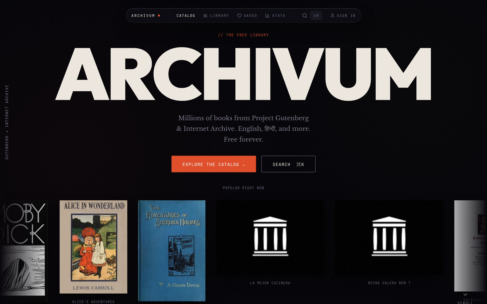

# 🏛️ Archivum

Archivum is a premium, high-fidelity digital library and e-reading application designed for the modern web. Built with React 19 and Vite, it acts as a gatekeeper to the world's greatest literature by integrating search and text fetching from **Project Gutenberg** and the **Internet Archive**.

The app features a custom, high-performance in-memory reading engine with a dedicated OCR/formatting cleanup pipeline, robust offline support, text-to-speech narration, character-anchored highlights and bookmarks, and a modern reading tracker.

---

## 🎨 Application Screenshots

### Premium Catalog & Curated Suggestions


### Dynamic Book Discovery Grid


### Curated Collection Details


---

## ✨ Features

### Reader Engine
- **📖 Chapter-by-Chapter Reader**: Unlike naive e-readers that load entire books into the DOM (causing massive performance lag), Archivum splits raw Gutenberg / Internet Archive text in-memory and loads exactly one chapter at a time, paginated into CSS columns.
- **🧹 OCR & Text Formatting Pipeline**: Raw Internet Archive OCR dumps and Gutenberg plaintext are cleaned up before rendering — title-page/front-matter detection and buffering, running headers and page-number junk filtering, hyphenated line-break rejoining (`distinc- tion` → `distinction`), `[Illustration: …]` markers converted to captions, and chapter headings detected (including `CHAPTER` / `BOOK` / roman numerals / Devanagari `अध्याय`). Unpaired `_` emphasis markers from OCR are stripped.
- **📱 Responsive Layout Adaptivity**: Dual-page spread layout with horizontal page flips for desktop screens, automatically transitioning to a clean single-column layout on mobile — with breakpoint-tuned hero and navigation scaling from 375px up to desktop.
- **🖌️ Opt-in Drop Caps**: Chapter-opening paragraphs get decorative drop caps, applied conservatively so scanned front matter isn't mangled.
- **🛡️ Sanitized Rendering**: All book HTML passes through a DOM sanitizer that strips event-handler attributes and `javascript:` URLs, keeping only a known allowlist of reader classes.

### Reading Tools
- **🎙️ Speech Synthesis (TTS)**: Native text-to-speech narration built directly into the reader. Adjust rate, pause/resume, choose from available system voices, and let narration auto-advance to the next page.
- **✍️ Character-Anchored Highlights**: Highlight text selections and persist them to Supabase. Highlights are stored as character offsets, so they restore to the exact position even after repagination, font-size changes, or window resizes.
- **🔖 Anchored Bookmarks**: Bookmarks jump back to the precise passage they were placed on (also offset-anchored), not just a page number that drifts.
- **🔎 In-Book Search** (`⌘/Ctrl + F`): Find passages within the current chapter.
- **🛠️ Fully Customizable Reader Environment**: Tweak body font sizes, line heights, page margins, and fonts (Georgia, Libre Baskerville, Serif) on the fly.

### Library & Progress
- **🔥 Gamified Reading Streaks**: Interactive heatmap tracker of reading consistency with a true consecutive-day streak calculation and a daily-goal ring fed by real minutes read per day.
- **⌨️ Command Palette** (`⌘/Ctrl + K`): Instant fuzzy search across the catalog with full keyboard navigation (↑ ↓ Enter), screen-reader labelled as a listbox.
- **💾 Local and Cloud Syncing**: Add books to your personal library and track progress automatically via Supabase — with a safe migration path that never deletes local data unless the cloud save has actually succeeded.

### Availability & Reliability
- **⚡ Layered Proxy Chain**: High-availability source fetching with automatic fallback:
  1. Dev source proxy (`/gutenberg`, `/ia`) — a Vite middleware that follows redirects (built-in proxying can't handle Gutenberg's 302s)
  2. Serverless edge function proxy (`/api/proxy`)
  3. Public CORS proxy backup
  4. Direct connection
  Failures surface a **Retry** button instead of a dead end.
- **📥 Offline & PWA**: Service worker caching (production only, so dev never serves stale modules), offline metadata caching, and a web manifest for installability.
- **🧷 Robust Scroll Management**: A counter-based scroll-lock manager handles nested modals and reader overlays, so the page never ends up permanently scroll-locked.
- **♿ Accessibility**: Labelled icon buttons, `aria-expanded` state, keyboard-first navigation, dialog/listbox roles, and WCAG-friendly muted-text contrast.

### ⌨️ Keyboard Shortcuts

| Context | Keys | Action |
|---|---|---|
| Catalog | `⌘/Ctrl + K` | Open search palette |
| Catalog | `↑` `↓` `Enter` | Navigate & open results |
| Reader | `←` / `PageUp` | Previous page |
| Reader | `→` / `PageDown` | Next page |
| Reader | `Space` | Toggle text-to-speech |
| Reader | `⌘/Ctrl + F` | Search within chapter |
| Reader | `Esc` | Close panels, then exit reader |
| Reader | `?` | Show shortcuts modal |

---

## 🛠️ Architecture & Tech Stack

- **Frontend Framework**: [React 19](https://react.dev/) + [Vite 8](https://vite.dev/)
- **Animation Engine**: [Framer Motion](https://www.framer.com/motion/)
- **Scrolling Physics**: [Lenis Smooth Scroll](https://github.com/darkroomengineering/lenis)
- **Database / Backend**: [Supabase JS](https://supabase.com/) (Authentication, progress syncing, user highlights)
- **Icons**: [Lucide React](https://lucide.dev/)

### Project Layout

```
├── api/
│   └── proxy.js              # Vercel edge function proxy (production fetching)
├── backend/
│   └── main.py               # Optional FastAPI proxy for local development
├── src/
│   ├── App.jsx               # Catalog, search palette, library, auth, stats
│   ├── components/
│   │   └── NativeReader.jsx  # Reading engine: pagination, formatting pipeline,
│   │                         #   TTS, highlights, bookmarks, themes
│   ├── lib/
│   │   ├── scrollLock.js     # Counter-based page scroll lock manager
│   │   └── readingStats.js   # Streaks, daily minutes, reading-day tracking
│   └── index.css             # Design system + reader typography
├── public/
│   ├── manifest.json         # PWA manifest
│   └── sw.js                 # Service worker (production only)
└── vite.config.js            # Dev server + source proxy middleware plugin
```

### Data Sources

| Source | Used for | Fetching |
|---|---|---|
| [Gutendex](https://gutendex.com/) (Project Gutenberg) | Metadata + clean plaintext ebooks | `/gutenberg` dev proxy → edge proxy → direct |
| [Internet Archive](https://archive.org/) | Scanned public-domain editions | `advancedsearch` API for discovery, `djvu.txt` OCR dumps for text (`/ia` dev proxy) |

Internet Archive scans arrive as noisy OCR; the reader's formatting pipeline (junk-line filtering, front-matter detection, hyphen rejoining) is what turns those raw dumps into readable pages.

---

## 🚀 Getting Started

### Prerequisites

- Node.js (v18 or higher)
- NPM or PNPM
- Python 3.10+ (optional — only for running the local FastAPI proxy backend)

### Installation

1. **Clone the Repository**
   ```bash
   git clone https://github.com/ARYAN007H/Archivum.git
   cd Archivum
   ```

2. **Install Frontend Dependencies**
   ```bash
   npm install
   ```

3. **Configure Environment Variables** (optional — the app works fully without an account; Supabase adds cloud sync)
   Create a `.env` file in the root directory and configure your Supabase variables:
   ```env
   VITE_SUPABASE_URL=your_supabase_url
   VITE_SUPABASE_ANON_KEY=your_supabase_anon_key
   ```

   > **Keep-alive:** Free-tier Supabase projects pause after 7 days without database activity. The scheduled workflow in `.github/workflows/supabase-keepalive.yml` queries the `keepalive` table every 6 hours. Add `SUPABASE_URL` and `SUPABASE_ANON_KEY` as repository secrets (Settings → Secrets and variables → Actions) to enable it; it can also be run manually from the Actions tab. Note that GitHub disables scheduled workflows in public repositories after 60 days without repository activity, so an external cron/uptime monitor is a sensible backup if the repo will be dormant.

4. **Start Dev Server**
   Run the Vite development server in the root directory:
   ```bash
   npm run dev
   ```
   Open `http://localhost:5173` in your browser. The dev server automatically proxies Gutenberg and Internet Archive traffic (`/gutenberg`, `/ia`), so no CORS setup is needed locally.

5. **Optional: Local Python Proxy Backend**
   Only needed if you want to self-host the fallback proxy instead of relying on the edge function:
   ```bash
   cd backend
   python3 -m venv venv
   source venv/bin/activate
   pip install -r requirements.txt
   uvicorn main:app --port 8000
   ```

---

## 🏗️ Building for Production

Compile the optimized bundles for deployment:
```bash
npm run build
```
To preview the production build locally:
```bash
npm run preview
```
The `/api/proxy` edge function is designed for [Vercel](https://vercel.com/) deployment; deploy the repo as-is and it will be picked up automatically.

### Linting
```bash
npm run lint
```

---

## 🛡️ License

Distributed under the MIT License. See `LICENSE` for more information.
